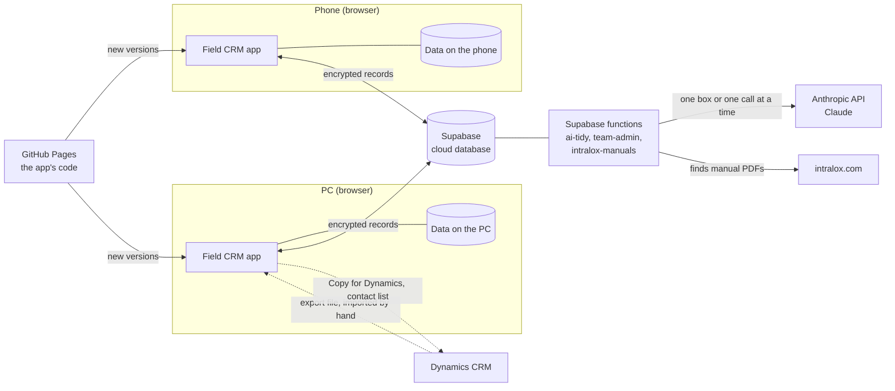

# 1. Overview

Field CRM is the app Intralox's ANZ field sales team uses on the road and at
the desk: planning visits, logging site calls with belts and health checks,
quote requests, call notes for customers, tasks and emails, account plans,
opportunities with their Blue Sheets, large account plans, and the CIP and
MBOs.

It is one app that runs in a web browser: on an Android phone (Chrome), an iPhone (Safari, iOS 16.4 or later) and a PC (Chrome or Edge).
It is installed from the browser like an app (a "progressive web app") and
works with no signal: everything it needs, and all your data, is kept on the
device. When there is signal it keeps the phone and the PC in step through a
cloud database.

## The parts

| Part | What it is | What it holds |
|---|---|---|
| The app | One web page (`index.html`, `app.js` and a few reference files) | Nothing of yours: it is the same for everyone |
| Data on each device | The browser's own database (IndexedDB) | All your data, unencrypted, protected by the device's own lock |
| Service worker (`sw.js`) | Keeps a copy of the app on the device | The app's files, so it opens with no signal |
| GitHub Pages | Where the app's code is published | The code only. The repository is public, so no customer data, keys or Intralox internal content ever go in it |
| Supabase | The cloud database, sign-in and three small server functions | Your records, encrypted before they left the device, which Supabase cannot read |
| Anthropic API | Claude, the AI | Nothing: it answers and keeps nothing |
| Dynamics | Intralox's CRM | The master contact and account list. The app has no direct connection: the export is imported by hand, and the app helps you copy things back |

## What happens where

- **Typing, logging, planning**: on the device, instantly, with or without
  signal.
- **Keeping devices in step**: through Supabase, automatically, when there is
  signal (see [Sync and security](03-sync-and-security.md)).
- **AI** (Tidy, Draft it, the coach, the visit summary, reading a spec sheet
  photo, setting up an opportunity from a description): through the `ai-tidy`
  function to Claude, only when you tap for it (see [AI](04-ai.md)).
- **New versions of the app**: from GitHub Pages when a pull request is merged;
  each device takes them after the app is closed and opened twice (see
  [Running it](06-running-it.md)).

## The team

The app can be used by one person or by a team of 4 to 10. A team shares call
reports, visits, plans, opportunities, products, saved notes and added
contacts; the admin keeps the shared CRM export and reference data; tasks,
planning weeks and the CIP/MBO stay private to each person. See the sharing
table in [Sync and security](03-sync-and-security.md#who-sees-what).
