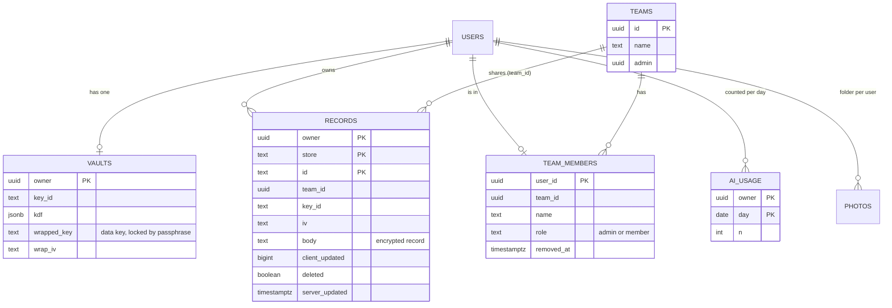
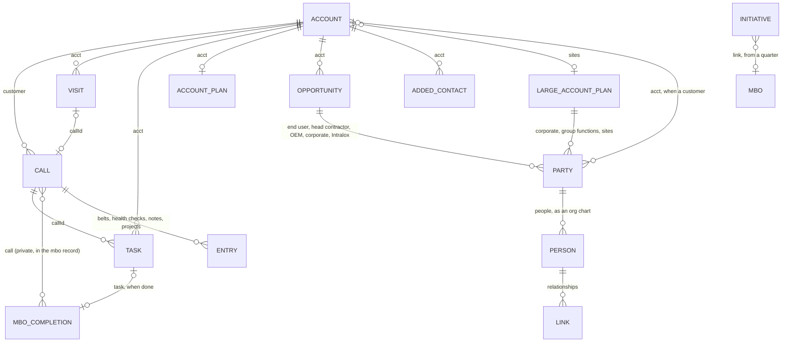

# 2. Database architecture

There are two databases. **Each device** (the phone, the PC) keeps a full copy
of your data in the browser's own database. **The cloud** (Supabase) holds an
encrypted copy of each record so the devices can find each other's changes.
The device copy is the one the app works from; the cloud copy is only ever a
go-between.

## 2.1 On the device

The browser database is IndexedDB, named `fieldcrm`, currently at **version 9**.
It has 11 stores (think of each as a table). Each store holds records looked up
by a key. The version number goes up whenever a store is added; the app moves
an older database forward by itself (see [Running it](06-running-it.md#when-the-database-version-goes-up)).

| Store | Key | One record is | Synced as | Shared with the team? |
|---|---|---|---|---|
| `accounts` | `a` (the account name) | One customer account and its contacts, from the CRM export | the `crm` dataset, whole | Read by all; written by the admin |
| `calls` | `id` | A call report, or a quote request (`rectype: 'quote'`) | record by record | Yes |
| `appts` | `id` | A planned visit or call on the calendar | record by record | Yes |
| `tasks` | `id` | A task or an email to write | record by record | **No, private** |
| `snippets` | `id` | A saved note (reusable text) | record by record | Yes |
| `products` | `id` | A product not stocked, new or requested | record by record | Yes |
| `plans` | `id` | An account plan, or a large account plan (`kind: 'large'`) | record by record | Yes |
| `opps` | `id` | An opportunity: its Blue Sheet and relationship map | record by record | Yes |
| `cip` | `me`, `mbo`, `ref` | Your CIP, your MBOs, and the CIP reference | record by record | **No, private** |
| `people` | `id` | A contact added on a Blue Sheet map who is not in the CRM export yet | record by record | Yes |
| `kv` | a name | Settings and whole datasets (see 2.2) | some, as datasets | See 2.2 |

### The records, field by field

Dates are written `YYYY-MM-DD` unless noted; times are stored as milliseconds
since 1970 (`updated`, `created`, `when`, `doneAt`). `updated` on a record is
what decides which copy wins when two devices changed it (see
[Sync and security](03-sync-and-security.md#when-two-devices-change-the-same-thing)).

**accounts** (built by importing the CRM export; replaced whole on each import)

| Field | Meaning |
|---|---|
| `a` | Account name, as in Dynamics (the key) |
| `sub` | Suburb or site, shown under the name |
| `z` | Zone code (e.g. `Z1`), from `zones.js` |
| `tier`, `foc`, `seg`, `team` | Account tier, focus (High, Medium, Low, No Focus), segment, team |
| `cad` | Visit cadence, set from the focus |
| `mgr`, `rep` | Account manager and representative |
| `grp` | The group or parent account, when the export has that column |
| `last`, `lastAppt`, `idle` | Last activity in Dynamics, and days since |
| `c` | The contacts: `n` name, `r` role, `t` title, `p` mobile, `e` emails, `id` Dynamics contact ID, and a few checks (`pk`, `ct`, `chk`, `mod`) |

Contacts added in the app are **not** written here; they live in `people` and
are laid in beside the CRM's own contacts in memory, marked `added`.

**calls** (call reports and quote requests)

| Field | Meaning |
|---|---|
| `id`, `date` (`dd/mm/yyyy`), `when` | Identity, the call's date, and when it started |
| `type` | Site call, Phone call, Teams call; or a quote request |
| `rectype` | `'quote'` for a quote request, otherwise absent |
| `customer`, `site`, `zone`, `suburb`, `focus`, `mgr` | The account and its details at the time |
| `contacts` | People on the call: `name`, `role`, `email`, `mobile`, `crm` (from the export or not), `cid`, and the per-contact document tick |
| `entries` | What was logged, in order. Each has a `type`: `belt` (the full belt specification: series, style, material, widths, sprockets, flights, sideguards, quantities, comments), `health` (fault, severity, recommended action, comments), `note`, or `project` (name, status, next action, target, owner, notes). Each can carry `photos`. A note or project is written here as it is typed (v133); a belt or health check on Done |
| `drafts` | A belt or health check form left half filled, by kind, offered back next time that form opens. Also a note or project form left without its text or name |
| `loose` | Photos not tied to an entry |
| `summary` | The visit summary that heads the call notes |
| `coaching`, `brief` | What the sales coach wrote, kept with the call |
| `status`, `closed`, `compiled`, `noReport` | Open / compiled (a document was made) / done (finished); done with nothing to report is a normal finished state |
| `test` | A made-up test call, removed by Settings > Delete tests |
| `updated` | Last real edit |

**appts** (visits on the calendar)

| Field | Meaning |
|---|---|
| `id`, `acct`, `type` | The account, and the kind of visit |
| `date`, `start`, `dur` | Day, start time and minutes |
| `agenda`, `contacts` | What it is for, and which of the account's contacts are invited |
| `status` | planned, in progress, done, missed or cancelled |
| `callId` | The call started from it |
| `brief` | The coach's pre-visit brief |
| `hold`, `icsSeq`, `expAt` | A placeholder (time held, no invitees), and the Outlook calendar file's version and last download |
| `touchedAt` | Last real edit |

**tasks**

| Field | Meaning |
|---|---|
| `id`, `type`, `title` | Type: Add project to Dynamics, Update project, Update contact details, Write email, Book travel, Book customer call, Call, Other |
| `date`, `start`, `dur` | When it sits on the calendar (30 minutes) |
| `acct`, `contact`, `email`, `mobile`, `project`, `revenue`, `notes` | What it is about |
| `mailTo`, `mailSubject`, `mailBody` | An email's To, Subject and Body |
| `done`, `doneAt`, `callId`, `created`, `updated` | Finished, when, and the call it came from |
| `mbo` | The MBO (`m:` and its id) or initiative (`i:` and its id) the task counts towards when done (v134) |

**snippets** (saved notes): `id`, `label`, `text`, `reason` (Won, Lost, Not
Qualified, Other), `created`, `lastUsed`, `updated`.

**products**: `id`, `name`, `part` (part number), `acct`, `status` (Not stocked,
New product, Requested to stock), `notes`, `stocked`, `stockedAt`, `created`.

**plans** holds two kinds of record.

*An account plan* (one per account): `id`, `acct`, `goal`, `people` (each `n`,
`role`, `mode`, `note`), `flags`, `strengths`, `updated`. Since v150, `lapObj`: the large account objective a site's plan supports.

*A large account plan* (`kind: 'large'`, across a customer's sites), laid out
as Dynamics' Large Account Plan:

| Field | Dynamics tab |
|---|---|
| `name`, `revenue`, `year`, `sharepoint`, `reviewed` | Key Plan Information |
| `vision`, `business`, `goals`, `insights`, `ladder`, `today`, `spendUs`, `spendAll`, `comp` | Key Plan Information: the Description's five parts (vision, account overview, business goals, key insights, Intralox position) |
| `objectives` (each `id`, `t`, `desc`, `revenue`, `period`, `owner`; v150: every one has an `id` that Blue Sheets and site plans point at) | Objectives |
| `strategies`, `invest`, `actions` (each `t`, `owner`, `due`, `done`) | Our own working, under Objectives |
| `sites` | Accounts |
| `strengths`, `flags`, `swopps`, `threats` | SWOT (strengths, weaknesses, opportunities, threats) |
| `csf` (six texts) | Critical Success Factors |
| `parties`, `people`, `links` | Its own relationship map (as an opportunity's, below); Team members are the Intralox people on it |

**opps** (an opportunity, its Blue Sheet and its map)

| Field | Meaning |
|---|---|
| `id`, `acct`, `name`, `obj`, `value`, `close` (`YYYY-MM`), `outcome` | The opportunity: objective, value, expected close, and Won / Lost / On hold |
| `pos`, `posWord`, `posWhy`, `vsComp`, `funnel`, `timing`, `comp`, `volNow`, `volPot`, `rep`, `criteria` | The Blue Sheet: position, competition, funnel, timing, volumes, ideal customer criteria |
| `parties` | The companies on the map: each `id`, `kind` (corp, div, grp, end, head, oem, ilx), `name`, `acct` (when it is one of our customers), `spec` (specified Intralox: yes / unsure / no), and by kind `status` (head contractor), `via` and `belts` (OEM), `covers` and `under` (group function: the sites it covers, the division it reports to), `site`, `hq`, `eng`, `engFor` and `div` (large account site: head office, group engineering there, the sites it engineers for, its division), and `works` (an OEM on a large account: each `to`, `how` (person, site, eng, proc, other), `who`, `note`) (v136) |
| `people` | Buying influences: `n`, `title`, `party`, `side`, `boss` (reports to), `role`, `role2`, `infl`, `stance`, `mode`, `rate`, `win`, `result`, `evid`, `note`, and `est`/`estFrom` when filled in from another Blue Sheet |
| `links` | Relationships between people: `a`, `b`, `kind`, `str` (Strong, Neutral, Weak, Hostile, or Unknown since v141: linked, strength not known, not counted as coverage), `note` |
| `flags`, `strengths`, `actions`, `notes` | Red flags (with information needed and from whom), strengths, possible actions (starred = best action plan), communication notes |
| `coaching`, `test`, `created`, `updated` | The coach's view, a made-up test project, and edits |
| `lap`, `lapPos` | The large account plan brought into this opportunity (its `id`), and where its boxes sit on this map (`{x, y, show}` by the plan's box id) (v139) |
| `lapObj`, `lapOff` | The large account objective this Blue Sheet delivers (the objective's `id`), and that it was unlinked and must not link itself again (v150) |
| `amGone` | Account managers taken off this map, by name in lower case, so they are not added back (v140). A large account plan's map keeps the same field |

An opportunity at a large account's site can bring that account in (v139). Its boxes over the site (corporate or the head office, the site's division, the group functions over it, the site that engineers for it, the OEMs working with any of them), their people and the links between those people are copied onto the map each time it is shown, under ids starting `lk-`. They are never saved in the opportunity: a change to their people, links or spec is written back to the plan when the opportunity saves, so the plan and every linked opportunity show it. Only where they sit is the opportunity's own (`lapPos`).

Relationships across sites (v140). A person can report to someone in another box: within a box it is `boss`; across boxes it is a `links` entry of kind `Reports to` from them to their manager. Each site's account manager (`effMgr`, the CRM export or the reassignment) is added to the Intralox box as a person with `am: true`. Between them and each person at a site there is an implied Our coverage link, worked out when the map is drawn and never stored; rating it stores it as an ordinary link, which is when the Blue Sheet counts it as coverage. A party with `amOff: true` has no implied links.

A large account's sites fill from the CRM export (v143): each contact for the site's account becomes a person with `crm: true` and `cid` (their Dynamics contact id), unless someone of that name is already there or the site's `crmOut` lists them (people taken off, by name in lower case). A site first filled from nothing gets `show: false`, so it is listed beside the map but not drawn; `crmFilled` marks that it has been filled once.

**people**, kind `staff` (v142): the Intralox people list, shared with the team in the same store as contacts added on maps. Each has `id`, `kind: 'staff'`, `n` (name), `pos` (AM, ATL, ITL, SS, AE, TSG, or another typed), `boss` (the `id` of the person they report to), `e` (email), `p` (phone), `added`, `by`, `updated`. A person in a map's Intralox box carries `sid`, the `id` of their record, once tied to it.

**people**, kind `chg` (v144): changes for Dynamics, for CAG, shared with the team in the same store. `type` is `move` (`n`, `cid`, `from`, `to`, and the contact's `t`, `e`, `p`), `edit` (`n`, `cid`, `acct`, only the changed `t` / `e` / `p`, and `was`), `atl` (`plan`, `acct` the large account's name, `sites`, `to`, `from`) or `owner` (an account manager change, made when it is marked sent: `acct`, `to`, `from`). Each has `at`, `by`, `updated`, and `sent` and `done` once those happen. A move or edit is laid over the contact list in memory until a CRM import has it (`moved`, `movedFrom`, `changed` on the contact; the export's own values kept in `_crm`, never stored). Account manager changes themselves are the reassignments in `mgrOf`. A large account plan's `atl` is its account team leader; a party's `atlOff` switches off the ATL's default links there.

Since v145 a change can also be `left` (`n`, `cid`, `acct`): the contact left the company, to remove from Dynamics, done once the export no longer has them. A person on a map with `hidden: true` was hidden as not relevant: kept, but not drawn, not rated and not on the Blue Sheet. Any box with an `acct` on a large account's map (an OEM, a contractor, corporate) fills from the CRM like a site.

**cip**: three records. `me` holds your CIP periods (goals, strengths, gaps,
reviews) and the four pillars; `mbo` your MBO list and claims by year and
quarter; `ref` the reference you import (job indicants, LCI principles, BU
goals, booklist). All three are private and never shared with the team.

The `mbo` record, one entry per year under `years`:

| Field | Meaning |
|---|---|
| `cap`, `setupLocked`, `mega` | The annual cap, whether the list is agreed, the Mega MBOs |
| `planning` | Next year's list being planned (v137): rolled over from this year's without values; it goes on 1 January |
| `items` | The MBOs: `id`, `cat`, `title`, `value` ($ each), `proof`, `def`, `buId`, `logLabel`, `books`, and `rules` (when a call ticks it itself: `focus`, `types`, `health`, `project`, `projDone`, `belt`) (v134) |
| `inits` | Initiatives, tracked and not paid (v134): `id`, `title`, `def`, `rules`, and `link` (`mbo`, `from`: counts towards that MBO from that quarter) |
| `quarters` | `Q1` to `Q4`: `locked`, `snap` (the values it was locked at), `log` (an MBO's completions by its id) and `ilog` (an initiative's). A completion is `site`, `date`, `ref`, and, when it came from the work, `call` or `task`, and `auto` when a rule ticked it |
| `off` | By call id, the ticks taken off a call that its rules must not put back |

A call's MBO ticks are kept here, never on the call: calls are shared with the
team, MBOs are not. A completion from a linked initiative is counted once,
however many ways the same call was ticked.

**people** (contacts added on maps): `id`, `acct`, `n`, `t` (title), `added`,
`by`, `from` (which Blue Sheet), `updated`. A record clears itself once a CRM
import brings the same name at that account.

## 2.2 Settings and whole datasets (`kv`)

| Key | What it is | Synced? |
|---|---|---|
| `meta` | Details of the last CRM import (file, rows, counts, and the hidden sheet Dynamics needs for write-back) | With the accounts, as the `crm` dataset |
| `beltref` | The belt and sprocket catalogue, from the plant audit workbook | Yes, dataset `beltref` (admin's, shared) |
| `assets` | The plant audit register (installed belts by asset number) | Yes, dataset `assets` (admin's, shared) |
| `overrides` | Zone corrections and spellings | Yes, dataset `overrides` (admin's, shared) |
| `mgrOf` | Account reassignments between managers | Yes, dataset `mgrOf` (admin's, shared) |
| `weeks` | Your planning weeks (which zone each week) | Yes, dataset `weeks`, private |
| `cloud`, `cloudKey`, `cloudTeam`, `cloudLater` | Sign-in, the unlocked key on this device, the team | No |
| `cloudSets`, `cloudDirty`, `cloudCursor`, `cloudSeeded`, `cloudOwners` | The sync's own bookkeeping (what is waiting to send, how far it has read) | No |
| `manualSrc`, `ixDocs`, `loadLog`, `usage` | Manuals downloaded, the import log, usage counts | No |

The engineering manuals themselves are kept as page images in the browser's
storage by `manuals.js`; the health-check fault library ships with the app
(`healthlib.js`).

## 2.3 In the cloud (Supabase)

One Postgres database. The app talks to it only through Supabase's sign-in and
its row-level security: every query is checked against the rules below, so a
device can only ever see what its user is allowed to.

| Table | What it holds | Plain fields the server can see | Encrypted |
|---|---|---|---|
| `records` | Every synced record, one row each. `store` is the device store's name (`calls`, `appts`, `tasks`, `snippets`, `products`, `plans`, `opps`, `cip`, `people`) or `datasets` for a whole dataset (`id` is then its name) | owner, store, id, team, when it was edited, whether it was deleted | `body`: the record itself |
| `vaults` | One per user: the data key, locked with a key made from the passphrase (PBKDF2, 600,000 rounds) | owner, which key | the data key |
| `teams`, `team_members` | Which team each person is in, who the admin is, who was removed and when | all of it (names only, no customer data) | — |
| `ai_usage` | How many AI requests each person made each day, for the 200-a-day limit | who, which day, how many | — (no text is ever stored) |
| Storage bucket `photos` | Call photos, in a folder per user, named by a hash of their content | the file names | the photo bytes |

### The rules (row-level security)

| Who | Can read | Can add or change | Can delete |
|---|---|---|---|
| You | Your own rows | Your own rows | Your own rows |
| Your team | Rows in stores `calls`, `appts`, `plans`, `products`, `snippets`, `opps`, `people` | The same stores | Only the author or the team admin; anyone else's delete is ignored and the row comes back |
| Your team | The admin's datasets except `weeks` | Only the admin writes shared datasets | — |
| Nobody else | Nothing | Nothing | Nothing |

`tasks`, `cip` and `weeks` have no team rule, so they stay private. A person
taken out of the team (`removed_at`) loses the team's data and key at once;
the team keeps reading what they wrote.

Two server-side rules guard every write (the trigger on `records`):

- **Newest edit wins.** A write carrying an older `client_updated` than the copy
  already there is skipped, so a device coming back online with stale data can
  never overwrite newer work.
- **A row keeps its owner and takes its owner's team.**

The schema is in `supabase/migrations/` (0001 to 0008), each file explaining
its step. They hold no data and no secrets.

## 2.4 How the records relate

Accounts are matched by **name**, exactly as Dynamics spells it. That is why a
CRM import that renames an account leaves its old calls and plans under the
old name; the zone overrides file corrects spellings.
