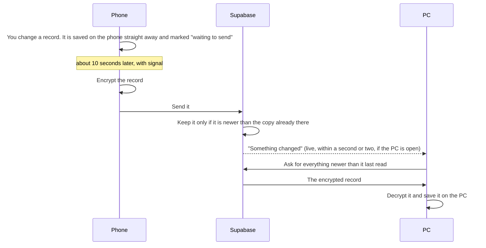

# 3. Sync and security

## How the phone and the PC stay in step

**When a sync runs** (nothing to press):

- when the app opens;
- when signal comes back;
- about 10 seconds after a change (a burst of changes goes as one);
- when you come back to the app after more than 20 seconds away;
- within a second or two of another device changing something, while the app
  is open (Supabase Realtime tells it a row changed; the message carries no
  data, the device then fetches as normal).

**What is sent.** Records go one at a time (calls, visits, tasks, saved notes,
products, plans, opportunities, CIP/MBO, added contacts). The CRM export, the
belt reference, the audit register, zone overrides, reassignments and planning
weeks go as whole datasets. Photos go to the photo store named by a hash of
their contents, so the same photo is only ever sent once.

**What is not sent.** Settings that belong to one device: sign-in details, the
manuals' page images, the import log.

## When two devices change the same thing

The newer edit wins, record by record. Each record carries the time of its
last real edit (`updated`, or `touchedAt` on a visit), and the server refuses
to replace a copy with an older one. So:

- Change a call on the phone, then a different call on the PC: both survive.
- Change the same call on both: the later change wins, the earlier is lost.
- Delete on one device: it is deleted on the other at its next sync. In a
  team, only the author or the admin can delete a shared record; anyone
  else's delete is ignored and the record comes back.

## Encryption

Everything that leaves a device is encrypted on that device first. Supabase
stores only scrambled text and cannot read your customers, notes or photos.

- **The data key.** Each person (or the team) has one random key (AES-GCM,
  256-bit). It encrypts every record and photo. Each record is also compressed
  first, and tied to its owner, store and ID, so a scrambled row cannot be
  moved onto another record.
- **The passphrase.** The data key is kept in your vault in Supabase, locked
  with a key made from your passphrase (PBKDF2 with SHA-256, 600,000 rounds).
  The passphrase never leaves the device. Each device asks for it once, then
  keeps the unlocked key on that device.
- **A team** shares one data key, locked with the team passphrase in the
  admin's vault. Members can read that vault; nobody outside the team can.
- **On the device** the data is not encrypted by the app: it relies on the
  phone's or PC's own lock and disk encryption. A lost phone that is locked
  keeps it safe; an unlocked one does not.

Sign-in is by email and password (Supabase Auth). Without a sign-in, nothing
in the cloud can be read or written at all.

## Who sees what

| What | You | Your team | Team admin | Supabase / anyone else |
|---|---|---|---|---|
| Call reports, quote requests, photos | Read, change, delete | Read and change | Read, change, delete | Scrambled only |
| Visits | Read, change, delete | Read and change | Read, change, delete | Scrambled only |
| Account plans, large account plans | Read, change, delete | Read and change | Read, change, delete | Scrambled only |
| Opportunities and Blue Sheets | Read, change, delete | Read and change | Read, change, delete | Scrambled only |
| Saved notes, products | Read, change, delete | Read and change | Read, change, delete | Scrambled only |
| Contacts added on maps | Read, change, delete | Read and change | Read, change, delete | Scrambled only |
| CRM export, belt reference, audit register, overrides, reassignments | Read (admin writes) | Read | Read and write | Scrambled only |
| Tasks and emails | Yours only | — | — | Scrambled only |
| Planning weeks | Yours only | — | — | Scrambled only |
| CIP and MBOs, initiatives, and which calls count towards them | Yours only | — | — | Scrambled only |

Without a team, everything is yours only.

## Kept out of the repository

The app's code is public on GitHub Pages. By rule (`CLAUDE.md`) none of these
ever go in it: customer names, contacts or CRM exports; the belt catalogue
(Intralox part numbers); the CIP and MBOs and their reference (Intralox
internal wording); any key or password. They are imported on a device and
travel only through the encrypted sync. The Anthropic key lives only in
Supabase's secrets.
