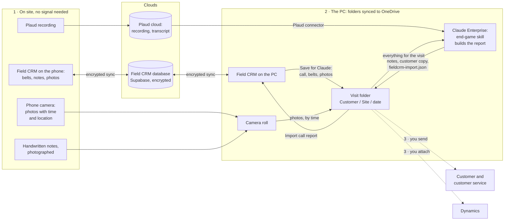

# 5. Data in and out

## Coming in

| What | From | Where it goes | Notes |
|---|---|---|---|
| **CRM export** | Dynamics, the ANZ Active Food Contacts view, as .xlsx (keeps the hidden sheet Dynamics needs for write-back) or .csv | `accounts`, and `meta` | Replaces the whole account list. Contacts added in the app survive it (they are in `people`). In a team, the admin imports it and it reaches everyone |
| **Belt reference** | `Plant_Audit_Template_1.xlsm` | `kv` `beltref` | Drives the belt form's pickers. The FORM v1.2 template does not import yet |
| **Plant audit register** | `Copy_of_Plant_Audit_Master_Database.xlsx` | `kv` `assets` | Installed belts by asset number. Replaced whole on each import |
| **Zone overrides** | A JSON file | `kv` `overrides` | Zone corrections and spellings |
| **CIP and MBO** | The CIP/MBO artifact's "Save HTML copy" | `cip` `me`, `mbo`, `ref` | Personal and private |
| **Blue Sheet** | A Miller Heiman Blue Sheet .xls or .xlsx | a new record in `opps` | Read by its labels, so a moved row still reads |
| **Belt Order Builder favourites** (v183) | Its Export favourites .json | the open account's order sheet | Belts and sprockets join the sheet; one already there (same id) is left as it is; older single choices become one-item lists. Accessories wait for a later version |
| **Task Slaughterer** | Its export, once | `tasks`, `snippets`, `products` | The old separate tasks page |
| **Engineering manuals** | intralox.com (found by the `intralox-manuals` function) or a PDF you pick | the browser's storage, as page images | pdf.js loads from a CDN the first time |
| **A shared file** | Android's share sheet | the call or form it was shared to | |
| **Shared words** (v177) | Android's share sheet, from any app (a Plaud transcript or summary, an email): text, or a .txt file | With a call open, a note on that call or cards in Capture (his choice each time); otherwise cards in Capture | The service worker parks shared text in the `fieldcrm-share` cache (`./shared-text`) for the page to collect. Sorting sends the words to `ai-tidy` (kind `capture`) in pieces of up to 5,500 characters, 12 at most |
| **Claude's call report** (v186) | `fieldcrm-import.json`, written by the end-game skill (Claude Enterprise on the PC) into the visit's PC folder; Import call report on the call's ⋯ reads it from there, or asks for the file on a phone | The same call: Claude's notes as `summary`, the internal notes as a `note` (`src` `claude`), belts (empty fields filled, new ones added with `src` `claude`), photos (any already on the call skipped), contacts (flagged not in the CRM where so), follow-ups marked as tasks as next steps on the planner, and the two documents in `report` | Asks first, saying what it adds. Never changes anything typed in Field CRM; importing the same report again adds nothing. A report made for another call asks before going in. The file kind is `field-crm-claude-report`, version 1 |
| **A copied or dragged picture** (v156) | The clipboard (Ctrl+V) or a picture file dragged onto a call, on the PC | the open entry's `photos`, or the call's `loose` | Shrunk like any photo; text on the clipboard pastes as text |

## Going out

| What | How | Format |
|---|---|---|
| **Call notes**, health check, belt requirements | Create and share on a call | Self-contained A4 HTML for the share sheet or a new tab; survives Outlook's renderer. Since v173 belts and health checks print conveyor by conveyor: the condition found (faults marked New belt and the belt's Why replace it), the belt to quote, what to fix on site and what to watch, and the checks that were OK; the belt requirements document leaves out the fixes, the health check document the belt spec. Every section and every conveyor folds under its heading, and a row of chips at the top (Condition, Belt spec, Fixes and watch items, Checks OK, Photos, Fold all, Open all) shows or hides one kind of thing; all start open. Folded or hidden parts are left out of a print. Copy for email arrives flat and complete. The quote request folds the same way and never carries the condition. The full call notes have a Next steps table (v174): what, project, when, for the next steps raised in the call, and those from earlier calls ticked off in it, struck through and marked Done. The full call notes list anyone marked as left during the call under Left the business, a red line each (v164). In the summary, comments, a note's text and a project's notes, a blank line starts a paragraph and lines starting with a bullet or - print as a list (v156: notes and project notes too) |
| **Evaluation** (v161) | Create and share on a call, Include: Evaluation only | A4 HTML for the engineer: every answer, starred ones still to come said so, estimates marked, each conveyor with its sprocket table, then the photos. Does not mark the call issued; the full call notes list the evaluations |
| **Belts reported** (v170) | The Belts card on an account, or Belts at this customer on a call being written (v171) | The belts logged at that customer in calls and quote requests, one row each (latest), ticked ones only: asset number, line or application (v171: split from the asset box, the words after the leading ones with digits), belt, width, length, date reported, note, status. As an A4 document (Copy for email, Document) or an Excel file |
| **Copy for email** (v159) | Create and share on the PC, Send to: Copy for email | The same document on the clipboard as formatted text and plain text, each element styled in place (Outlook drops stylesheets), with no pictures or logo (Outlook on the PC blocks pictures held in the document); marks the call issued like a download |
| **Quote request (RFQ)** | Create and share on a quote | A4 HTML. Since v159 there is no Required by or Your reference (an older quote that has them still prints them), a belt needs no asset number (it is named by its line description, else "No asset no."), and an account not in the CRM is typed in the same box as the search |
| **Order form** (v183) | Send order form, on an account's order sheet | One self-contained HTML file for the customer: the ticked favourites only, with the catalogue's answers baked in (the colours made in each material, each sprocket's description and part number), and no notes for sales. The customer picks Quote or Order, builds the request and copies it into an email as inline-styled tables (and plain text) that survive Outlook |
| **Blue Sheet** | Create and share | PDF (the print screen's Save as PDF) or Excel in Miller Heiman's template layout |
| **Large account plan** | Create and share | A4 HTML in Dynamics' order |
| **Copy for Dynamics** | The large account plan | Each Dynamics field with its own Copy button |
| **Changes for CAG** (v144; its own section of Settings since v158) | Settings, Changes for CAG | .xlsx for CAG: new contacts, moved contacts, changed details, left the company (v145) and account owners (account managers, ATL), a sheet each. Since v158 each row has what Dynamics has now beside what it changes to (job role, job title, email, mobile, owner), when it was made and by whom, and a Check column for a job role or title Dynamics does not hold. Then marked sent; the To send tab shows the same before downloading |
| **Visits and tasks to Outlook** | The calendar | .ics calendar file: subject "Type: Account", location, agenda, the contacts to see listed in the notes, focus and zone as categories. Since v163 no organiser and no invitees, so Outlook holds each one as your own appointment and never offers to email a customer an update or cancellation. Since v162 dated tasks go in the same file as appointments (not Outlook tasks, which a calendar file cannot carry): subject "Title - Account", no invitees, category "Field CRM task", only those new or changed since the last download |
| **Email tasks to Outlook** | Open in Outlook | A new email (mailto): To, Subject (or the title), Body |
| **Planning weeks** | The planner | .ics calendar file of week markers |
| **PC folder** | Reports | Each done call saved as files in a folder on the PC |
| **Save for Claude** (v186) | A call's ⋯ | The call for the end-game skill: `Field CRM call.json` (kind `field-crm-call-for-claude`, version 1: the call with every entry and its place in the call as `ref`, its contacts, and the account's CRM contacts and account manager) in the visit's PC folder (`Customer\Site\date`, as Save to PC folder), its photos beside it in `from Field CRM`. On a phone, or without folder access, one file to download with the photos inside it. Not on a quote request |
| **Export for Claude** | Reports | Text files for a Claude Project |
| **Backup** | Settings | One JSON file of everything on the device, photos optional |

Rejected formats, by decision: EML (Outlook on Android opens it as a web page)
and PDF for call notes (the Blue Sheet is the exception).

## The call report with Claude: how the data flows (v186)

Solid lines happen in the apps; dotted lines are done by hand today. The two
lines to and from the database are Field CRM's own sync, encrypted on the
device: Claude is never on them. Claude reads and writes only the visit
folder (and the Plaud recording), so the call reaches the database the way
every call does, when Import call report saves it.

## Backup and restore

**Back up** (Settings, Backup and restore) writes one file with every store, the settings that
matter, and optionally the photos. Contacts added in the app go in it
separately from the accounts. Since v180 it also carries Capture's words and
cards not yet sorted, and the notes held for a customer's next call.

**Restore** adds and updates records by their IDs; it never deletes anything
already on the device. Capture's words in the file are taken only when the
device has none waiting, so an older backup never replaces newer words. With cloud sync on, a restored record then syncs like
any other change.

Cloud sync is itself a second copy of everything except device-only settings,
so a new or wiped device gets everything back by signing in and entering the
passphrase. It is not a backup, though: a delete reaches every device. The
backup file is the undo.
